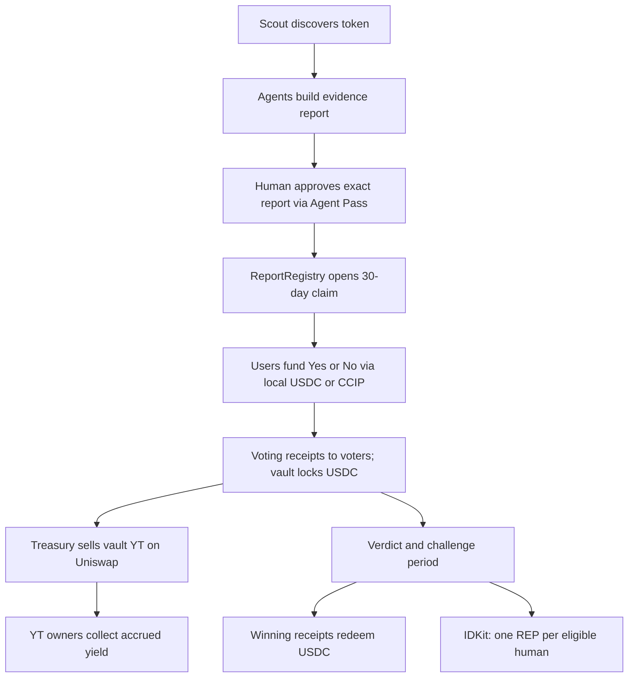
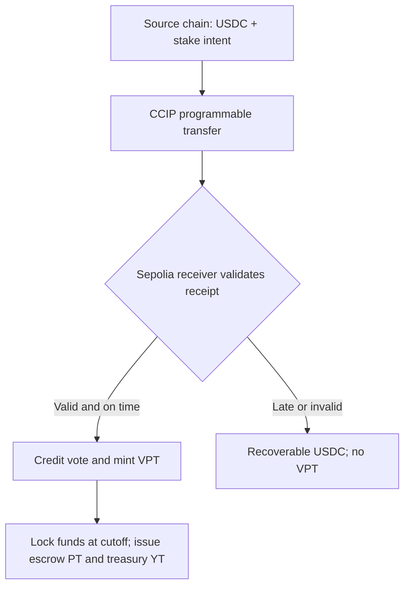
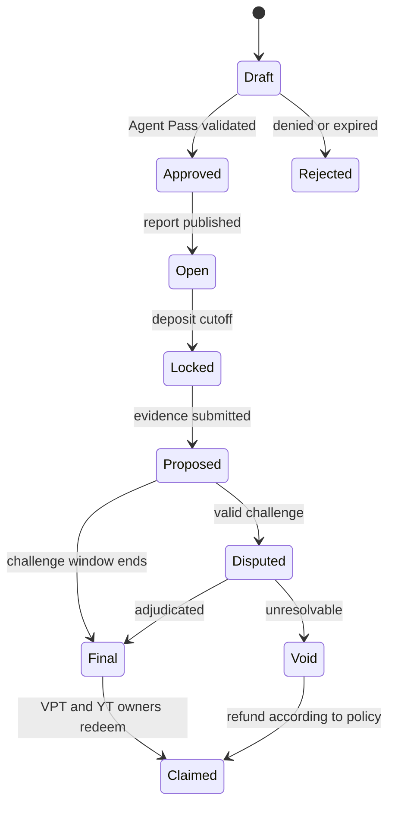
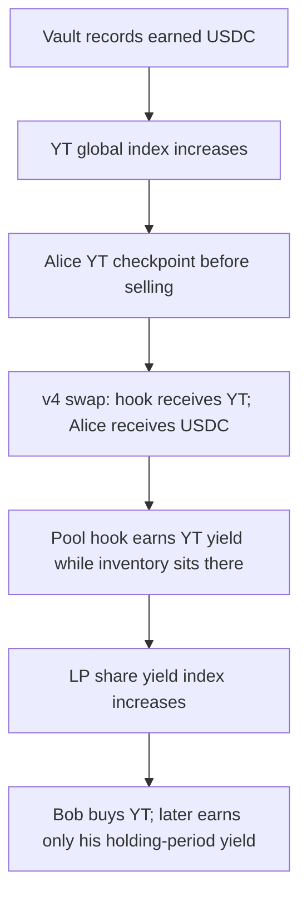

# RiskFi / BB8 — Final Mumbai Build Plan

**Version:** 6 November 2026 (IST), implementation proof edition  
**Submission:** New ETHGlobal Mumbai project; not a Continuity submission  
**Chosen sponsors:** World (Agent Pass and IDKit), Chainlink CCIP 2.0, Uniswap v4  
**Status:** Implementation plan, not a claim that contracts are deployed or integrations are working.

## 1. The product in one minute

RiskFi investigates a suspicious token and publishes an interactive evidence report with one **precise, resolvable 30-day claim**. A human approves the agent's proposed report before a market can open. People deposit USDC on **Yes** or **No**, directly on Ethereum Sepolia or from a specifically supported source chain using CCIP. Winning voters redeem their original stake plus **80% of the losing side's stake**, split according to the number of USDC units they staked. RiskFi receives the other **20% of the losing pool**. Separately, the locked USDC earns variable yield. A claim on that future yield, YT, trades on Uniswap. A verified winning human can receive **one non-transferable REP badge per report** using IDKit; REP never withdraws stake principal.



**Important distinctions:** A risk score is not a verdict. A report must publish its actual claim and evidence rule before staking. CCIP delivery is not a vote until collateral is credited. A Uniswap YT price is not an oracle for the report verdict. World verification does not make a public stake or swap anonymous.

**Time model for version 1:** publish the report and open deposits, close remote deposits early enough for CCIP delivery, then close all deposits at a fixed `lockTime`. Take the claim's baseline observation and start its **30-day measurement and YT accrual period at `lockTime`**; `maturity = lockTime + 30 days`. A late bridged deposit enters recovery, even if its source transaction began before lock. Commit these timestamps and the baseline observation rule before the first stake. Withdrawal happens after maturity **and** the resolution/challenge process; maturity alone does not choose Yes or No.

## 2. Fixed economics and token rights

### Voting payout

Let `W` be the winning side's USDC, `L` the losing side's USDC, `s` the winning holder's voting-token balance, and `f = 0.20`.

`winner payout = s + floor(s × L × (1 − f) / W)`; `treasury fee = floor(f × L)`; loser payout = 0. State how remaining rounding dust is swept only after all claims expire or are redeemed. All amounts are USDC base units with consistent rounding and a solvency check. The fee is charged on **the losing pool only**.

| Example: Yes wins | Amount |
|---|---:|
| 80 Yes voters × 1 USDC | 80 USDC |
| 20 No voters × 1 USDC | 20 USDC |
| Treasury: 20% of losing 20 | 4 USDC |
| Shared across 80 winning units | 16 USDC |
| Each Yes voting token redeems | **1.20 USDC** |
| Each No voting token redeems | **0 USDC** |

`80 × 1.20 + 4 = 100`; no money is created. For a one-sided, invalid, disputed beyond the published deadline, or unresolvable report, use an explicit **Void** outcome and return accepted principal pro rata, without a losing-pool fee. Define the exact dispute/void authority before deposits are allowed.

### Three claims, not two

| Instrument | Holder at issue | Economic right | What happens at maturity |
|---|---|---|---|
| `Yes-VPT` / `No-VPT` (ERC-1155 voting position) | Voter | Verdict-dependent payout on deposited USDC | Winner burns to redeem; loser pays zero; Void refunds under published rule |
| Pendle-style `PT` (principal claim) | Settlement escrow | Recover the pooled vault principal for distribution under the VPT rule | Escrow redeems principal; voters cannot redeem PT independently |
| Pendle-style `YT` (yield claim) | Treasury initially; later trader/LP | Accrued interest on corresponding vault principal while held, before maturity | Future earning stops; earlier accrued interest stays claimable |
| `REP` (non-transferable badge) | One IDKit-verified winning human per report | Reputation only; no USDC redemption or same-market verdict rights | Persists as a badge, subject to the published reputation policy |

This preserves the **Pendle-style separation of principal and yield** while respecting the RiskFi rule that a losing voter forfeits principal. Never give voters both freely redeemable principal PT and their VPT: that would back two redemption claims with one deposit. The treasury may sell YT, but then the buyer receives that token's future yield; the treasury retains the sale proceeds, not both sale proceeds and the sold yield.

Use a **single report and a common vault accrual start/end for the first YT series**. Weekly fungible YT spanning different deposit dates requires index-normalized share accounting and is deferred. YT must update each holder's earned yield **before every mint, burn, and transfer**; otherwise a late buyer could take an earlier owner's accrual. At maturity freeze the index and preserve unclaimed amounts. **A normal v4 pool does not automatically distribute yield accrued on YT held by its shared PoolManager to that pool's LPs.** The implementation proof in §9 chooses hook-owned liquidity and explicit LP yield accounting. Do not deploy a normal v4 pool and claim Pendle-like yield streaming without this proof.

The vault must report actual assets, principal, and yield. A negative yield or withdrawal shortfall reduces available assets; define and test a principal-shortfall waterfall before live funds. The hackathon may use a clearly labeled simulated vault for a complete short demo, with a real yield adapter only when a tested market exists on the chosen chain.

**YT is not a loan:** traders buy/sell a right to the *actual* future interest on locked USDC. There is no borrower returning YT at expiry, no promised 8% interest bill, and no automatic “12% profit minus 8% fee” mechanism. Borrowing would require a separate collateralized lending/liquidation protocol and is outside this build.

## 3. Sponsor integrations

### World Agent Pass — publication gate

1. Investigator produces a versioned `report.json` and interactive HTML tied to a canonical content hash. The claim includes token chain/address, measurement method, start and end observations, sources, challenge window, and Void policy.
2. A designated human reviewer sees the exact hash and requests Agent Pass approval. Backend verifies the result and binds it to `(reportHash, claimHash, reviewer, nonce, expiry)`.
3. Backend's authorized publisher signs or sends `ReportRegistry.publish`. On-chain authorization checks publisher role, immutable hashes, nonce, and deadlines. No frontend-only flag can open a market.
4. Demonstrate **approved → published** and **denied/expired → still Draft**. Document backend validation and integration feedback. Agent Pass hackathon proofs are mocked; do not describe them as production identity assurance.

### World IDKit — unique-person REP claim

Use the **Proof of Human** credential for one REP reward per winning human per report. IDKit is optional for cash payouts: a winner redeems VPT without proving identity. When claiming REP, the backend verifies the proof, binds it to an eligible winning recipient, checks the nullifier has not already been used **for this report**, and issues a short-lived report-bound authorization. `Reputation` verifies signer, nonce, expiry, report, and recipient, and mints at most one REP for the scoped nullifier. A person may stake with multiple wallets but may claim only one badge. Verify World’s action/nullifier configuration against the actual SDK before implementing report scoping; a stable app action plus a `(reportId, nullifier)` uniqueness key is one candidate. Do not expose the raw nullifier on-chain if a scoped hash suffices.

Show **valid winner → one REP**, **same person/second wallet → rejected**, and **cancelled/unavailable/ineligible → no REP**. REP is not a second collateral receipt, transferable asset, or vote on its own report.

### Chainlink CCIP 2.0 — funded cross-chain vote

Deploy source `CCIPStakeSender` on **one verified CCIP-supported testnet** and destination `CCIPStakeReceiver` on **Ethereum Sepolia**. Verify direction, USDC token route, routers/selectors, and fee token against the current CCIP directory before deployment. Source transfers USDC and sends `{protocolVersion, reportId, side, recipient, nonce, deadline, minAmount}` in a programmable token transfer. Destination allows only the official router plus configured source selector and sender, validates the received token/amount, ensures message and nonce are unused, and calls the same funded-credit function as a local deposit. **That destination state change is the Chainlink prize proof.**

Store CCIP message ID and expose `Sent → In transit → Delivered → Credited` to the frontend. A late, underfunded, malformed, or failed application receipt is held as **recoverable USDC**, not counted as a vote or a PT mint. The user or authorized recovery flow can reclaim it; retries cannot create a second stake. Require a safety gap between the cross-chain entry cutoff and the local stake cutoff.



### Uniswap v4 — trading the yield

Create a report-specific YT/USDC v4 pool on Ethereum Sepolia with a **custom-accounting, hook-owned market** as detailed in §9. Treasury seeds the hook with issued YT and **separate treasury-owned USDC**, never USDC backing VPT. The frontend executes a real v4 swap through a compatible router with slippage protection. `YieldMarketHook` controls its YT/USDC inventory, attributes its YT yield to LP shares, enforces maturity, and settles each swap's PoolManager deltas. Its mined address permissions must match its callbacks. LPs must be able to withdraw after maturity. Display the price as an explicitly labeled *market-implied* rate; do not use a thin pool price as a fraud oracle. **A valid router swap on the actual deployed v4 contracts is a hard acceptance gate**; custom accounting is a substantial integration and cannot be assumed to work from a local mock.

Uniswap submission: public open-source repo, `FEEDBACK.md`, developer feedback form containing its link, and README pointers to the exact integration files and lines.

## 4. Smart-contract inventory

| Contract/module | Chain | Must implement |
|---|---|---|
| `ReportRegistry.sol` | Ethereum Sepolia | Immutable report/claim hashes and market settings; authorized publish; status and events |
| `VoteMarket.sol` | Ethereum Sepolia | USDC custody/credit, Yes and No totals, deadlines, local stake, CCIP receiver-only credit |
| `VotingPositionToken.sol` | Ethereum Sepolia | ERC-1155 `(reportId, side)` balances; restricted mint and burn |
| `CCIPStakeSender.sol` | Source | Quote fee, transfer approved USDC, encode message, `ccipSend` |
| `CCIPStakeReceiver.sol` | Ethereum Sepolia | Router/source/token checks, replay protection, successful credit, failed-fund recovery |
| `YieldVaultAdapter.sol` | Ethereum Sepolia | Deposit/withdraw and asset valuation for a selected real or labeled mock yield source |
| `YieldSplitter.sol` | Ethereum Sepolia | Mint principal PT to Settlement and YT to Treasury; hold backing and control maturity |
| `PrincipalToken.sol` | Ethereum Sepolia | Principal accounting claim, escrowed in Settlement |
| `YieldToken.sol` | Ethereum Sepolia | ERC-20 YT; holder index, accrued interest on transfers, `claimYield` |
| `Settlement.sol` | Ethereum Sepolia | Evidence/result proposal, challenge/finalize, `redeemVPT`, Void, shortfall and rounding |
| `Reputation.sol` | Ethereum Sepolia | Non-transferable REP; signer-verified, single-use, IDKit-backed winning-human claim |
| `Treasury.sol` | Ethereum Sepolia | Fee receipts, initial YT inventory, separate USDC liquidity budget |
| `YieldMarketHook.sol` | Ethereum Sepolia | v4 custom accounting; hook-owned YT/USDC reserves; swap settlement; trading cutoff; hook-held YT yield to LP index |
| `YieldLPShare.sol` | Ethereum Sepolia | LP ownership/shares and accrued-yield checkpoints on LP mint, burn and transfer |

**Contract invariants:** a position mints only against received USDC; CCIP credits once; PT escrow cannot be withdrawn by a losing voter; outstanding principal and yield claims never exceed recoverable assets under the published loss rule; PT/VPT/YT claims cannot be redeemed twice; public functions are reentrancy-safe; no unbounded payout loop. Use pull payments. Small modules may be combined during implementation if these boundaries remain auditable.

## 5. Backend and frontend

| Layer | Work |
|---|---|
| Scout | Watch token/pool events, deduplicate candidate by chain/address, record trigger and data freshness; queue investigation, not automatic accusation |
| Investigation | Run source-backed contract/liquidity/market checks; retain block, source, method, units, uncertainty and counterevidence; prepare a precise resolvable claim |
| Report publishing | Generate sanitized interactive HTML plus canonical manifest; bind both to immutable hashes; request and validate Agent Pass approval |
| Resolution service | Evaluate exactly the precommitted predicate at cutoff, submit result/evidence, support challenge and Void; no AI prose as settlement oracle |
| Identity service | Request IDKit proof, verify with World, enforce nullifier uniqueness, issue short-lived on-chain REP authorization |
| CCIP monitor | Track source tx, CCIP message, destination tx, credited position or recovery balance |
| Frontend | Candidate/report explorer; reviewer approval; chain/asset quote and stake; CCIP progress; VPT balances and possible payouts; YT price/trades; result and USDC/yield/REP claims |

## 6. State transitions and adverse paths



**Policies to encode before deposits:** report claim and resolver; cutoff and dispute timing; 20% losing-pool fee; one-sided/Void refund; late CCIP recovery; selected principal-loss allocation; YT start/end and transfer accrual; REP eligibility and nullifier scope. A timer does not execute `finalize()` by itself: make finalization permissionless after an authenticated verdict and challenge window, or operate an authorized keeper.

## 7. Build order and demonstration

1. **Core accounting:** local funded vote, VPT, result and withdrawal. Test 80/20 Yes outcome, 80/20 No outcome, different stake sizes, one-sided/Void, rounding, repeat claim, and no fake funds.
2. **World Agent Pass:** reviewed hash matches published hash; refused review cannot open market.
3. **CCIP:** a real testnet source transfer creates an Ethereum Sepolia funded vote; retry, malformed and late deliveries remain safe/recoverable.
4. **Vault and split:** deposit into a labeled mock first, then actual yield adapter if verified; mint escrow PT and Treasury YT; test loss and maturity.
5. **Uniswap:** initialize a real YT/USDC v4 pool; treasury LP; trader buy/sell; correct yield index across transfers; LP exit and YT claim.
6. **World IDKit and REP:** eligible verified human receives one REP; second wallet and cancelled verification fail; VPT USDC payout works without IDKit.
7. **Judge demo:** agent report → approval/denial → local and CCIP stakes → YT trade → accelerated *demo* maturity and evidence result → 1.20-per-winning-unit redemption → yield claim → one-human REP. State clearly that the intended market is 30 days and the demo clock/yield is simulated where applicable.

This is a **new project** submission. Maintain dated commits for work created during the event, use permitted general-purpose dependencies, disclose any earlier RiskFi project-specific material, and follow ETHGlobal's applicable from-scratch requirements. A design narrative does not establish deployment or prize eligibility.

## 8. Primary references

- [ETHGlobal Mumbai prize rules](https://ethglobal.com/events/mumbai/prizes) and [ETHGlobal rules on prior work](https://ethglobal.com/rules)
- [World IDKit integration and nullifiers](https://docs.world.org/world-id/idkit/integrate); [World Agent Pass documentation](https://auth.world.org/docs)
- [Chainlink CCIP defensive programmable token transfers](https://docs.chain.link/ccip/evm/tutorials/application-developers/programmable-token-transfers-defensive) and [testnet directory](https://docs.chain.link/ccip/supported-networks/testnet)
- [Uniswap v4 hooks](https://developers.uniswap.org/docs/protocols/v4/concepts/hooks) and [deployments](https://developers.uniswap.org/docs/protocols/v4/deployments)
- [Pendle yield-tokenization mechanics](https://docs.pendle.finance/pendle-v2-dev/Contracts/YieldTokenization)

## 9. Option A: engineering proof for a genuinely streaming YT/Uniswap market

### 9.1 Concrete, testable design

**Market:** one YT series for one locked 30-day report; one authorized YT/USDC v4 PoolKey. Use Uniswap v4 **custom accounting/return deltas** so `YieldMarketHook` owns the market's actual YT and USDC inventory. Do not credit the singleton `PoolManager` with YT accrual and then assume a standard Uniswap LP NFT can claim it. The hook implements a deliberately simple reserve curve (constant product with bounded fee and minimum reserves), and **all token movements and flash-accounting deltas must balance in the same v4 unlock**. This is an implementation design to prove, not a ready-made Uniswap feature. Start with one seeded treasury LP, then add permissionless LPs after the one-LP conservation proof.

**Yield:** `YieldSplitter` deposits accepted USDC through `YieldVaultAdapter` only at lock, then issues equal principal and yield *notional* for that start time. PT goes to Settlement escrow and YT to Treasury. `YieldToken` maintains `globalIndex` in USDC per YT, holder `paidIndex`, and `unclaimedUSDC`. When the adapter recognizes distributable **positive yield actually backed by withdrawable assets**, checkpoint increases the index once. Before any YT balance changes, settle the holder's `balance × (globalIndex − paidIndex)`; then change balance and paid index. Claim withdraws/uses backed yield without reducing principal reserves. A negative rate/asset shortfall pauses new yield recognition and invokes the published shortfall rule. At maturity freeze the index; YT future-earning value is zero and existing claimable yield remains payable.

**LP ownership:** `YieldMarketHook` is itself a YT holder and receives accrual whenever YT resides in its inventory. Before every swap and LP change, checkpoint the hook's pending YT yield into `lpYieldPerShare` using the **previous** LP share supply. On LP entry/exit or LP share transfer, checkpoint each owner's `balance × (lpYieldPerShare − paidLPIndex)`. When the hook receives backed USDC yield, it reserves that balance for LP yield withdrawals rather than counting it as swap reserve. LP additions made after a checkpoint cannot take earlier LP yield. At expiry allow LPs to withdraw inventory, freeze accrual, and claim their due share; handle the hook's remaining YT and its matured accrued yield explicitly.

**Swap custody:** When buying, a trader pays USDC via the v4 swap unlock and receives YT *from the hook*; when selling, the hook takes YT and pays USDC. Checkpoint `YieldToken` for both sides at the current index before inventory changes. The swap price is established by hook reserves and trade size, not forced to the vault's current APY. The hook must reject a wrong PoolKey, wrong token ordering, unauthorized reserve manipulation, zero/expired trades, invalid fees and unsafe slippage. Do not assume the standard Universal Router supports every custom-accounting arrangement: prove the exact router path on an Anvil deployment and on Sepolia before claiming this integration is complete.



### 9.2 The proof that Option A works

Use a deterministic, interval-controlled vault in Foundry. Total principal = 1,000 USDC, mint 1,000 PT to Settlement and 1,000 YT to Treasury. Start with treasury as LP holding 500 YT in the hook and Treasury holding the remainder. Give Alice some YT through a real v4 swap, advance a period and inject/recognize precisely **10 USDC** of yield; checkpoint. Alice sells a portion back through v4, Bob buys through v4, advance another period and recognize **15 USDC** of yield. Alice, Bob, Treasury and the LP withdraw their attributed yields.

Acceptance assertion: **sum of all holder, treasury and LP yield claims equals 25 USDC** (allow only bounded integer rounding dust); no one can claim more than their balance-time share; Bob has no claim to the first period; Alice keeps her first-period due yield after selling; liquidity added after the first period does not capture its yield. Repeat with multiple LPs, LP share transfer, swap before and after a checkpoint, partial claim, double claim, maturity, Vault loss, fee-on-transfer rejection, reentrancy attempt and arbitrary PoolKey. Fuzz balances, swap directions, timing and liquidity; assert principal + recognized-yield liabilities + recoverable CCIP balances never exceed controlled assets under the explicit shortfall model.

**Gate:** if a real Uniswap v4 router swap or LP yield attribution cannot be proved on the actual PoolManager, stop before Sepolia deployment and correct the hook architecture. Do not silently switch to an expiry-only payout while calling it Pendle-like YT. An expiry-only cash claim has a different price path: it converges to its accumulated payout instead of going to zero.

### 9.3 Realistic economic proof

For **10,000 USDC** of locked principal and an illustrative **8% annual** rate, estimated 30-day total interest is about **65.75 USDC**, not 8% of principal. If traders paid 50 USDC for all 10,000 YT at inception, 4%, 8%, and 12% realized annual rates would yield about 32.88, 65.75, and 98.63 USDC respectively, before swap fees and gas. A small change in expected rate, vault loss risk, or time remaining changes bids. Market price is created by actual liquidity and trader demand; the hook does **not** magically enforce price decay. With only 100 USDC staked, 8% annual yield for 30 days is about 0.66 USDC across the entire market: too little for a useful real trade after likely transaction costs. Larger pooled cohorts with a common accrual schedule are a future product task, not part of the first audited series.

## 10. Contract API, deployment and integration handoff

### 10.1 Suggested application API (final signatures follow installed versions)

| Module | Actions | Important checks |
|---|---|---|
| Registry | `publishReport(hash, claimSpec, deadlines, auth)`, `getReport(id)` | Agent Pass backend attestation bound to exact hash, authorized signer, expiry and replay guard |
| VoteMarket | `stakeLocal(id, side, usdcAmount, recipient)`, `creditCCIP(id, side, received, recipient, messageId)` | `SafeERC20`, measured receipt, open window, min stake, CCIP receiver-only and once per ID |
| CCIP source | `quoteFee`, `stakeRemote(reportId, side, recipient, amount, deadline, minCredit, extraArgs)` | Supported lane/token, fee, expiration, avoid hard-coded extraArgs when lane features differ |
| CCIP destination | `ccipReceive(message)`, `recover(messageId)` | Router, source selector + sender, USDC token and amount, recovery ownership, replay guard |
| YieldSplitter | `lock(id)`, `checkpointYield(id)`, `claimYield(account)`, `mature(id)` | Equal PT/YT notional, real backing, immutable expiry, principal reserved |
| YieldMarketHook / LPShare | `initializeSeries`, `addLiquidity`, `removeLiquidity`, `claimLPYield`; v4 hook callbacks | Permission flags, PoolKey, hook-owned reserves, settlement deltas, LP checkpoint ordering, non-reentrancy |
| Settlement | `propose`, `challenge`, `finalize`, `redeemVPT` | Predicate and evidence fixed at publish, outcome once, pull payouts, Void, fee and rounding |
| REP | `claimWinnerREP(id, recipient, scopedNullifier, expiry, backendSig)` | IDKit proof verified off-chain, recipient owns qualifying win, used nullifier per report, signer/nonces |

No YT or PT can be minted against a CCIP message that is still in transit. USDC amounts use six-decimal base units; token ordering and all price-scale conversions must be explicit. Model timestamps and expiry in seconds, and read the official router, pool, token, selectors and Aave market at deploy time rather than copying illustrative addresses.

### 10.2 Repository shape

```text
contracts/src/{ReportRegistry,VoteMarket,VotingPositionToken,Settlement,Reputation,Treasury}.sol
contracts/src/ccip/{CCIPStakeSender,CCIPStakeReceiver}.sol
contracts/src/yield/{YieldVaultAdapter,YieldSplitter,PrincipalToken,YieldToken}.sol
contracts/src/uniswap/{YieldMarketHook,YieldLPShare}.sol
contracts/test/{Voting,CCIP,YieldAccounting,UniswapHook,WorldAuth,Integration}.t.sol
contracts/script/{DeploySepolia,DeploySource,ConfigureLane,SeedPool,VerifyDeployment}.s.sol
backend/src/{scout,investigate,report,agent-pass,idkit,resolver,ccip-tracker}/
frontend/src/{reports,review,stake,positions,yield-market,claims}/
deployments/{sepolia,source-testnet}.json
README.md  FEEDBACK.md
```

### 10.3 Ordered test and deployment gates

1. **Local primitives:** `forge test`; voting 80/20/20% payout and Void; REP only once; LP/index conservation proofs above; invariant/fuzz tests. Use Anvil CCIP simulator for source-to-destination and failed delivery; no wallet keys in repo.
2. **Chain preflight:** Ethereum Sepolia has deployed Uniswap v4 and Aave V3 test market. Verify *actual USDC in the Aave market* and its interest behavior. Chainlink's published USDC tutorial demonstrates **Ethereum Sepolia → Arbitrum Sepolia**, while this plan needs **source → Ethereum Sepolia**. Before choosing Arbitrum Sepolia as source, query current CCIP directory/router for the **reverse USDC+data route** and test `getFee`/supported token. If unavailable, pick another verified source chain; do not deploy an impossible route or falsely claim arbitrary-chain support.
   The destination CCIP-delivered token, local-deposit USDC, Uniswap quote token, and vault reserve asset must be **the same ERC-20 address**. Aave testnet USDC and CCIP-delivered USDC may differ. If they do, require a tested, bounded conversion with measured output and explicit failure recovery; otherwise use a labeled mock yield adapter with the CCIP-delivered USDC and defer the real Aave adapter. Do not silently treat two USDC-branded test tokens as interchangeable.
3. **Sepolia deployments:** testnet USDC and gas obtained from legitimate faucets; deploy Registry/market/tokens/vault/settlement/REP; deploy hook with mined v4 permission address; initialize pool; fund treasury USDC independently; seed hook inventory; execute actual router buy and sell; collect LP and trader yield in a short explicitly simulated series. Check every address against explorer and export deployment JSON.
4. **Source deployment:** deploy sender on selected second testnet, configure allowlisted selectors/senders/tokens on both chains, send a small CCIP deposit, wait for destination credited VPT and record the CCIP message ID and both transaction hashes. Test a late or invalid receipt with recovery.
5. **Real-yield check:** swap adapter to verified Aave Sepolia USDC supply only after checking valuation, withdrawals, and zero/negative yield cases. Do not imply that an accelerated mock accrual was real lending interest.
6. **World integration:** configure Agent Pass server secrets and IDKit app/RP/action; test successful/denied approval and successful/cancelled/duplicate REP. Never put server secrets or signing keys in frontend. World approval validates a claim publication; IDKit validates per-human reputation, not votes.
7. **Release verification:** `forge test`, `forge fmt --check`, static analysis if available, deployed read/write smoke tests, full browser walkthrough, public repo, exact README addresses/code pointers and Uniswap feedback submission. Never put a production private key in scripts or frontend; deployment requires a funded account and user-controlled credentials.

### 10.4 Frontend/backend request and data contracts

| View/API | Inputs and output | Chain or service boundary |
|---|---|---|
| `/api/candidates` | chain/address, trigger, freshness, quality; queue state | Scout + evidence store; does not auto-publish |
| `/api/reports/:id` | exact manifest/hash, evidence/uncertainty, immutable claim | Backend content matched to on-chain registry hash |
| `/api/agent-pass/request`, `/callback` | reviewer, report hash, nonce, validated status | Server verifies Agent Pass, authorizes registry write; denies on mismatch/expiry |
| `/api/stake/quote` | source chain, token, amount, CCIP fee, destination minimum, expiry | Reads on-chain supported route and live fee; no quote for unsupported asset |
| `/api/ccip/:messageId` | source confirmation, verified delivery, accepted credit/recovery | Index both transaction events; chain is custody source of truth |
| `/api/yield/:series` | vault APY as estimate, actual accrued index, pool price, implied APY and LP rewards | On-chain vault + v4 state; never present estimates as promised returns |
| `/api/idkit/verify` | proof, report, recipient; short-lived authorization or failure | Server verifies proof/nullifier and chain eligibility; contract enforces one-time use |
| `/api/claims/:account` | VPT cash, YT due interest, LP due interest, REP eligibility | Chain data; user signs each withdrawal; cache cannot grant rights |

Frontend pages: Discover → evidence report → reviewer approval → stake (local/CCIP status) → positions → YT market (real USDC/ YT swap; quote and slippage) → result and three distinct claims (VPT USDC, YT interest, IDKit REP). Show pending CCIP as pending, and market risk/expiry clearly. Public staking and swaps remain observable; no anonymity claims without a separate privacy mechanism.

### 10.5 Source and limits

This plan uses current primary docs: [Uniswap custom accounting](https://developers.uniswap.org/docs/protocols/v4/guides/custom-accounting), [v4 hook setup](https://developers.uniswap.org/docs/protocols/v4/guides/hooks/getting-started), [v4 liquidity](https://developers.uniswap.org/docs/protocols/v4/guides/managing-liquidity/overview), [Universal Router](https://developers.uniswap.org/docs/protocols/v4/guides/swapping/routing), [Sepolia deployments](https://developers.uniswap.org/docs/protocols/v4/deployments), [Aave testnet guidance](https://www.aave.com/docs/aave-v3/smart-contracts/testing-and-debugging), and [CCIP USDC-with-data guide](https://docs.chain.link/ccip/evm/tutorials/application-developers/usdc). The exact source→Sepolia USDC lane and exact v4 custom-hook router interaction are **verification gates**, not already-proven integrations. The app is a new submission and prior RiskFi project-specific code cannot be silently reused under Classic rules.
